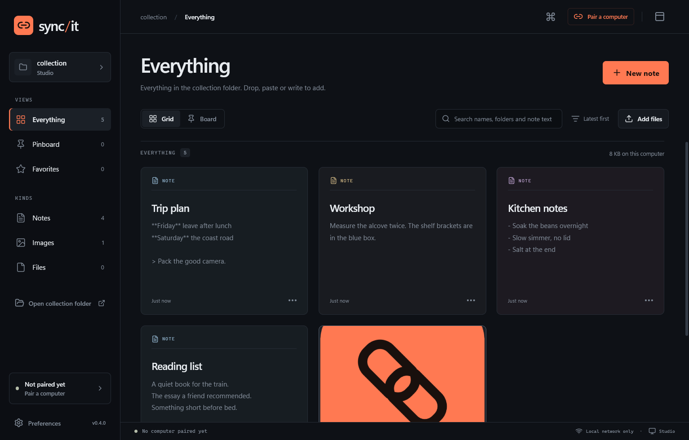
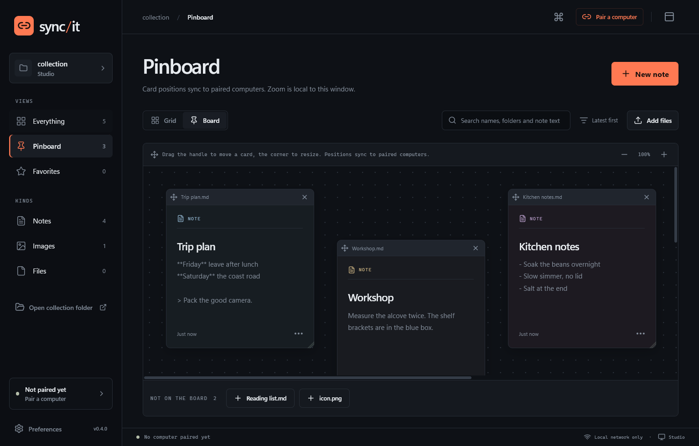
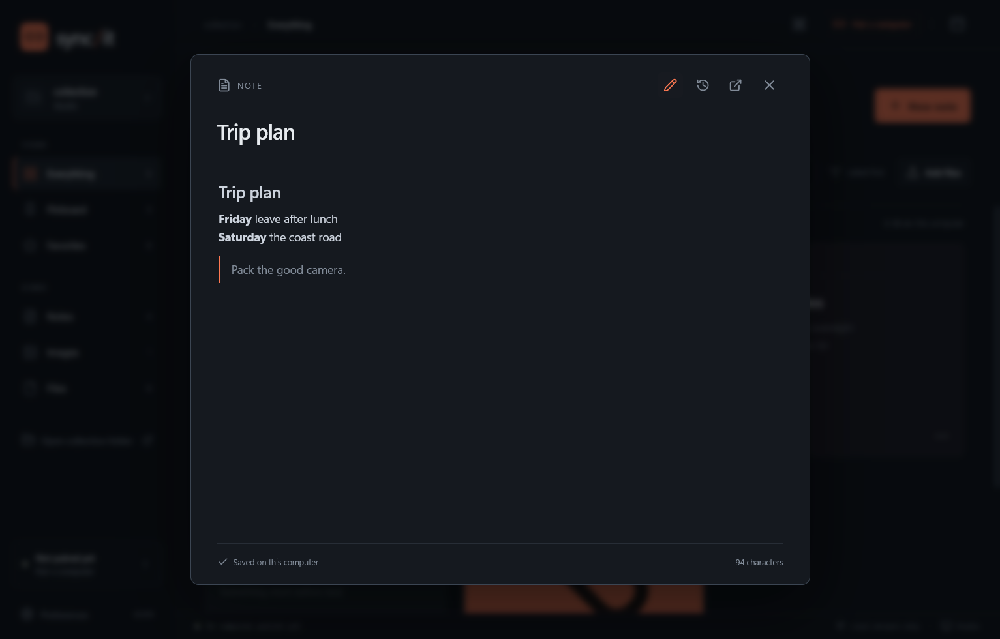
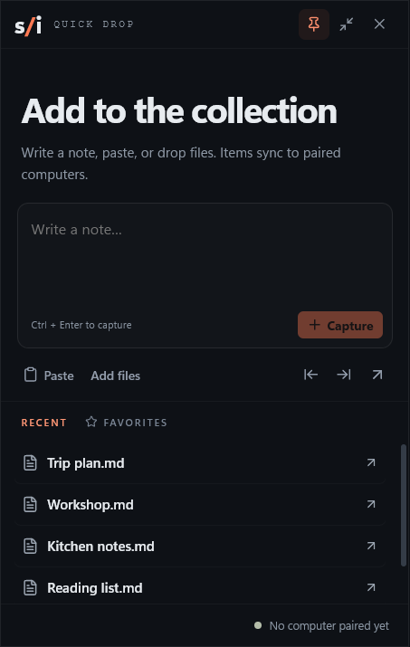
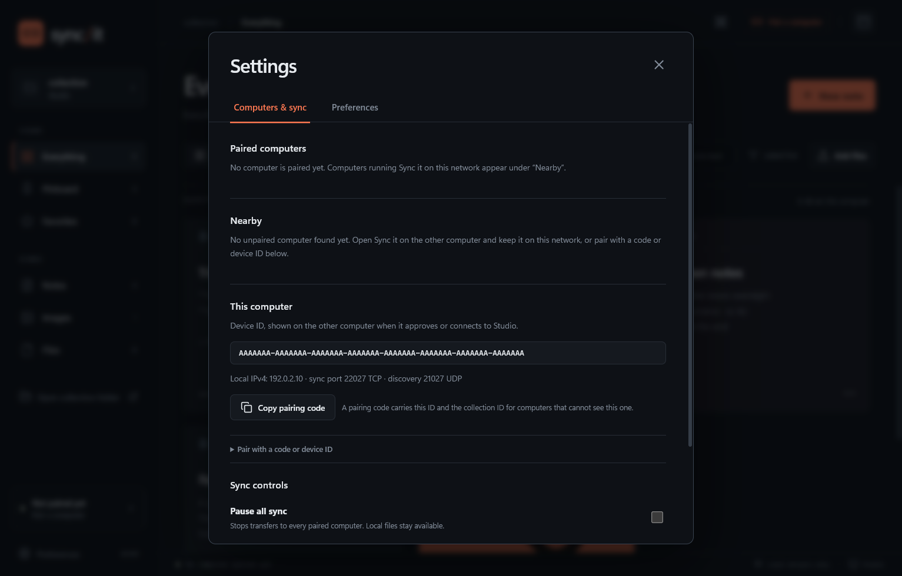

# Sync it

One folder of files, screenshots and notes, kept identical on the computers you pair, over your own network. No account, no cloud, no server.

[](https://github.com/thesiyonara/sync-it/actions/workflows/ci.yml)
[](https://github.com/thesiyonara/sync-it/releases/latest)
[](LICENSE)



## What it is

Sync it is a desktop app for Windows and macOS. It keeps a normal folder, the **collection**, and syncs it directly between paired computers on the same local network using a bundled, pinned [Syncthing](https://syncthing.net) engine. On top of that folder it gives you a searchable grid, a shared pinboard, a note editor with history, and a small floating window for capturing things quickly.

- **Yours.** Files stay ordinary files on your disks. Nothing leaves your network; there is no account, relay, telemetry or web font.
- **Direct.** Computers find each other on the LAN and pair with a device ID you confirm. Transfers are encrypted end to end by Syncthing.
- **Honest.** The interface shows real state only: what is paired, what is syncing, what conflicted.

## Features

- Grid of notes, images and files with folder context, search over names, folders and note text, and filters for favorites and conflicts.
- Note editor with autosave, read-only Markdown preview, and **History** to preview and restore earlier versions, including versions archived from received changes.
- Shared pinboard: card positions sync; zoom stays local.
- Quick drop: a floating window (Ctrl/⌘ Shift Space) to write a note, paste a screenshot or drop files from anywhere.
- Pairing without a code from a Nearby list, or with a code or device ID when discovery is blocked. Any number of computers; each can be revoked.
- Untrusted devices: give a NAS an encryption password and it holds an encrypted copy it cannot read.
- Conflicts keep both versions. Deleted files go to the Recycle Bin or Trash, and received overwrites keep 30 days of versions.
- Tray menu, command palette, and an authenticated local CLI for scripting.
- Phone access (preview): an opt-in LAN service lets a paired phone browse the collection; an iPhone app scaffold is in `mobile/ios`.
- In-app updates, downloaded from this repository's releases and verified against published checksums.

| Pinboard | Note with Markdown preview | Quick drop |
| --- | --- | --- |
|  |  |  |

## Install

Download the package for your computer from the [latest release](https://github.com/thesiyonara/sync-it/releases/latest):

- **Windows 10 or 11:** `Sync-it-X.Y.Z-win-x64.exe`, a normal installer.
- **macOS 13 or newer:** `Sync-it-X.Y.Z-mac-arm64.dmg` for Apple Silicon or `Sync-it-X.Y.Z-mac-x64.dmg` for Intel. Drag Sync it to Applications.

Builds are not yet signed with a developer identity, so Windows SmartScreen and macOS Gatekeeper warn on first launch. On Windows choose **More info → Run anyway**; on macOS right-click the app and choose **Open**, or allow it under System Settings → Privacy & Security. Every release ships a `SHA256SUMS-X.Y.Z.txt` you can check the download against.

On first launch, choose the collection folder (`~/Sync it` by default) and whether to start at login.

## Pair your computers

1. Install and set up Sync it on each computer, on the same network.
2. On one computer open **Computers & sync**. The other computer appears under **Nearby** with its device ID. Compare the ID with the one shown on that computer, then **Connect**.
3. On the other computer, **Approve** the request. Both computers adopt one collection ID; existing files are merged, never deleted.

If discovery is blocked, use **Pair with a code or device ID**: copy a pairing code on one computer and paste it on the other, or enter the device ID and local IPv4 address. Allow the app through the firewall on private networks: TCP **22027** for transfers, UDP **21027** for discovery. Guest Wi-Fi and client isolation prevent direct connections.



## Everyday use

- Drop files or folders into the dashboard, into Quick drop, or straight into the collection folder with Explorer or Finder. App imports copy the original.
- Paste text or a screenshot to create a note or a PNG. The clipboard is read only when you paste.
- Notes autosave. Plain text and Markdown up to 1 MB open in the editor; larger files open in their default app.
- Pin cards from a card's menu or from the strip under the pinboard. Drag the handle to move, the corner to resize.
- Closing the dashboard keeps syncing from the tray or menu bar; **Quit** stops it.

The app does not encrypt files on disk; use your operating system's disk encryption. Sync is not a backup: a deletion propagates. Received overwrites and deletions keep 30 days of versions under **Preferences → File recovery**.

## Updates

**Preferences → App updates** checks this repository's releases, downloads the package and the release's checksum file, verifies the download, and opens the installer only when you ask. Daily checks are opt-in. Details in [docs/UPDATES.md](docs/UPDATES.md).

## Security

Loopback-only engine controls, private app storage with restrictive permissions, a sandboxed renderer with a deny-by-default network policy, pinned helper hashes, Electron fuses, and path containment on every file operation. The model, the hardening and the known limits are described in [docs/SECURITY.md](docs/SECURITY.md); report vulnerabilities through [SECURITY.md](SECURITY.md).

## Development

Node.js 24 on Windows 10+ or macOS 13+.

```sh
npm ci
node node_modules/electron/install.js
npm run fetch:engine
npm run dev
```

```sh
npm run typecheck
npm test              # unit, security, control, updates, Markdown, phone access
npm run test:sync     # two real Syncthing engines on loopback
npm run test:ui       # Electron UI flows; opens windows
npm run screenshots   # regenerates docs/screenshots from a throwaway profile
```

Packaging: `npm run dist:win` on Windows, `npm run dist:mac` on a Mac (`bash scripts/build-mac.sh` also verifies the bundle). `npm run fetch:engine` downloads the pinned Syncthing release, extracts the exact executable, checks its header and fails if `shared/engine-integrity.json` disagrees. Releases are built by GitHub Actions from a `vX.Y.Z` tag; see [docs/RELEASING.md](docs/RELEASING.md).

Layout: `electron/` is the main process (files, settings, Syncthing supervision, IPC, windows, tray, phone access, updates); `src/` the React renderer; `shared/` the typed bridge; `scripts/` build, release and test drivers; `mobile/ios` the iPhone scaffold; `docs/` the design, security, testing, CLI, updates and mobile notes.

Contributions are welcome; read [CONTRIBUTING.md](CONTRIBUTING.md) first. Changes are listed in [CHANGELOG.md](CHANGELOG.md).

Development credits, including OpenAI Codex and Anthropic Claude, are in [CONTRIBUTORS.md](CONTRIBUTORS.md).

## License

MIT. Syncthing is bundled unmodified under the MPL-2.0; see [THIRD_PARTY_NOTICES.md](THIRD_PARTY_NOTICES.md).
